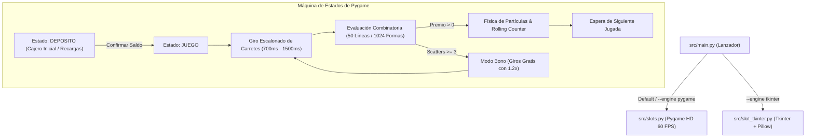

# Documentación Técnica: Gemini Royal Slots 5x4 HD

**Autor:** Roberto Alejandro Chagra Martínez  
**Tecnologías:** Python 3, Pygame 2D (60 FPS, HD 1366x768), Tkinter, Pillow (PIL), Física de Partículas, Algoritmia Combinatoria  
**Tipo:** Plataforma Unificada de Simulación de Casino y Probabilidad  

---

## 1. Arquitectura de Motores y Estados

El proyecto consolida una arquitectura modular con dos motores gráficos complementarios y un despachador unificado:



---

## 2. Modelos Matemáticos de Evaluación de Premios

### 2.1. Modo 50 Líneas de Pago Geométricas (`PAYLINES`)
Cada línea de pago $i \in \{1, \dots, 50\}$ define una trayectoria $\mathbf{p}_i = [r_0, r_1, r_2, r_3, r_4]$ donde $r_c \in \{0, 1, 2, 3\}$ representa la fila ocupada en la columna $c$.

1. **Sustitución de Comodines:** El símbolo comodín `Wild` sustituye a cualquier símbolo regular $s \ne \text{Scatter}$.
2. **Coincidencias Consecutivas ($M$):** Se contabilizan de izquierda a derecha hasta la primera discrepancia:
   $$M = \max \left\{ k \in \{1,\dots,5\} \mid \forall c < k, \; \text{símbolo}(c, r_c) \in \{s, \text{Wild}\} \right\}$$
3. **Multiplicadores por Longitud:**
   $$\mu(M) = \begin{cases} 0.60 & \text{si } M = 3 \\ 0.80 & \text{si } M = 4 \\ 1.00 & \text{si } M = 5 \\ 0 & \text{en otro caso} \end{cases}$$
4. **Pago por Línea:**
   $$\text{Pago}_i = \left\lfloor \text{ValorBase}(s) \times \text{ApuestaLínea} \times \mu(M) \right\rfloor$$

### 2.2. Modo 1024 Formas (*All-Ways to Win*)
Calcula el número de caminos posibles de izquierda a derecha a través de columnas consecutivas:
$$\text{Formas}_s = \prod_{c=0}^{L-1} \left( \text{count}_c(s) + \text{count}_c(\text{Wild}) \right)$$
Donde $L \ge 3$ es la longitud de la racha ininterrumpida. El pago escala multiplicando las formas totales por el valor base del símbolo y la tasa por longitud.

### 2.3. Símbolos Dispersos (*Scatter*) y Modo Bono
Independientes de las líneas de pago activas:
$$\text{TirosGanados} = \begin{cases} 10 & \text{si } \text{cols}(\text{Scatter}) = 3 \\ 25 & \text{si } \text{cols}(\text{Scatter}) = 4 \\ 100 & \text{si } \text{cols}(\text{Scatter}) = 5 \end{cases}$$
Durante el modo bono se aplica un multiplicador global de **$1.20\times$** a todas las ganancias acumuladas.

---

## 3. Ponderación de Símbolos y Frecuencias

| Símbolo | Sprite en `assets/` | Peso (`SYMBOL_WEIGHTS`) | Valor Base (`SYMBOL_BASE_VALUES`) | Tipo de Símbolo |
| :--- | :--- | :---: | :---: | :--- |
| **Wild** | `assets/wild.png` | 8 | 200 | Comodín sustituto |
| **Scatter** | `assets/Scatter.png` | 8 | 0 | Disparador de giros gratis |
| **Heart** | `assets/heart.png` | 12 | 120 | Premium Superior |
| **Diamond** | `assets/diamond.png` | 14 | 90 | Premium |
| **Fruit** | `assets/fruit.png` | 18 | 60 | Intermedio |
| **A** | `assets/A.png` | 22 | 30 | Baja denominación |
| **B** | `assets/B.png` | 26 | 20 | Baja denominación |
| **C** | `assets/C.png` | 30 | 15 | Baja denominación |
| **D** | `assets/D.png` | 34 | 10 | Baja denominación |

---

## 4. Motor de Partículas y Cinemática

La clase `EfectoParticula` modela partículas de confeti/monedas doradas con un sistema cinemático discreto a $60\text{ FPS}$:
$$\mathbf{x}_{t+1} = \mathbf{x}_t + \mathbf{v}_t$$
$$\mathbf{v}_{y, t+1} = \mathbf{v}_{y, t} + g, \quad g = 0.32\text{ px/frame}^2$$
$$\alpha(t) = \max\left(0, \left\lfloor \frac{\text{vida}(t)}{\text{vida\_max}} \times 255 \right\rfloor\right)$$

---

## 5. Instrucciones de Ejecución

```bash
# Lanzador principal con selección de motor:
python src/main.py --engine pygame
python src/main.py --engine tkinter

# Ejecución directa Pygame HD:
python src/slots.py
```
